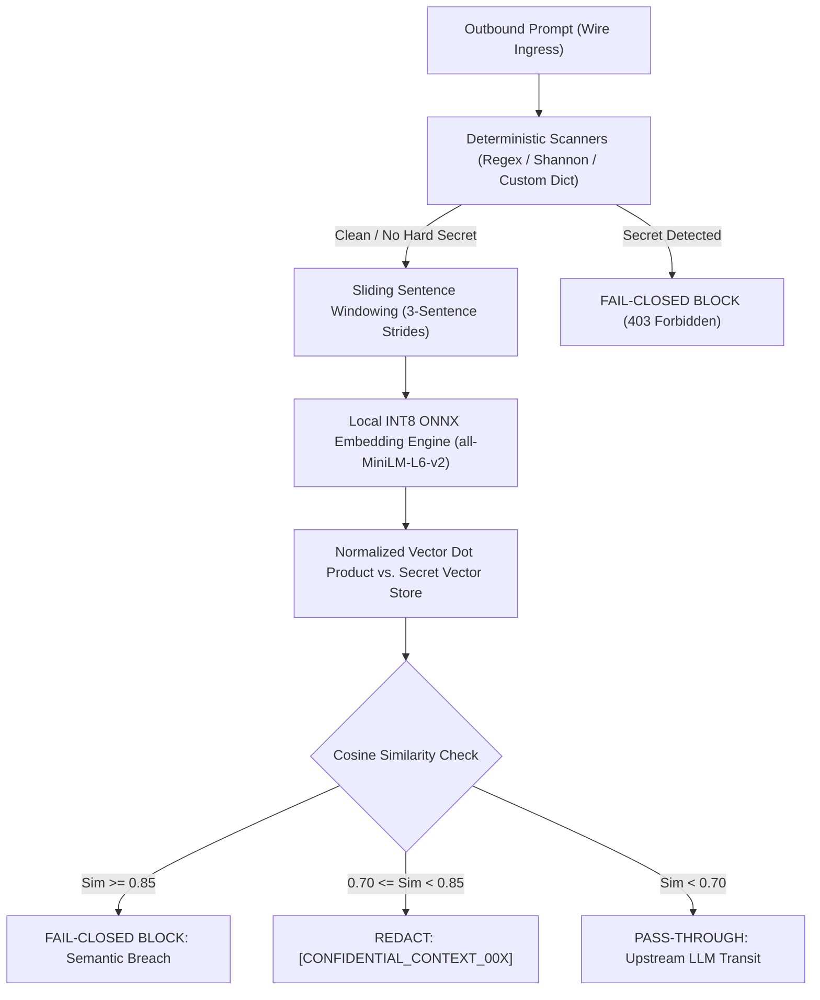

# Architectural Blueprint: Local Vector & Embedding Guardrails

> **Target Objective:** Build an ultra-low-latency (<15ms), 100% on-device semantic vector guardrail engine for the Veil Privacy Gateway to intercept paraphrased confidential information, trade secrets, and proprietary intellectual property without relying on cloud embeddings or regex keywords.

---

## 1. Executive Summary & Problem Formulation

Deterministic regex and entropy scanners excel at structured secrets (API keys, credit cards, emails, SSNs). However, enterprise data leakage frequently occurs via unstructured, paraphrased natural language:
* Unreleased quarterly earnings projections ("*we expect operating margins to compress by 400bps in Q3 due to APAC supply delays*")
* Internal system architecture disclosures ("*our primary sharded cluster uses secret bypass port 9443 without mTLS*")
* Proprietary algorithms described conceptually without exact variable names.

To intercept these disclosures wire-level before packets leave the local host, Veil requires **Local Dense Embedding Guardrails** operating entirely in-memory with zero external API dependencies.

---

## 2. System Architecture & Pipeline Flow

---

## 3. Technology Stack & Component Specifications

| Subsystem | Component | Rationale & Specifications |
| :--- | :--- | :--- |
| **Embedding Engine** | **ONNX Runtime (CPU)** + `all-MiniLM-L6-v2` (INT8 Quantized) | • Memory footprint: **22.8 MB** • Inference latency: **6–11ms** on modern x86/ARM CPU • Dimension: **384-dimensional dense vectors** • Zero Python heavy framework dependencies (no PyTorch/transformers runtime required) |
| **Vector Storage** | **Memory-Mapped Cosine Matrix (NumPy / USearch)** | • Local flat L2-normalized vector store (`secret_embeddings.bin`) • Search complexity: $\mathcal{O}(N)$ dot product for $N \le 5,000$ rules executes in $<0.2\text{ms}$ |
| **Tokenizer** | **HuggingFace `tokenizers` Fast Rust C-Bindings** | • Sub-millisecond tokenization (WordPiece/BPE) • Integrated directly via static binary or pre-compiled tokenizer.json |
| **Circuit Breaker** | **`CircuitBreaker("vector_guardrail", timeout_ms=25.0)`** | • Strict 25ms execution ceiling • Automatic fallback to `EmbeddedSemanticClassifier` if latency spikes or ONNX session fails |

---

## 4. Latency Budget Analysis (<15ms Wire Budget)

To ensure developers and AI agents (Cursor, Antigravity, OpenCode) experience no noticeable keystroke or streaming lag, the entire semantic evaluation must finish within a **15ms ceiling**:

```mermaid
gantt
    title Latency Budget Breakdown (Total Budget: 15ms)
    dateFormat X
    axisFormat %s ms
    section Ingress
    Text Sliding Windowing (0.5ms)     :0, 1
    section Tokenization
    Rust Fast Tokenizer (1.5ms)         :1, 3
    section Inference
    INT8 ONNX Session Run (8.5ms)      :3, 11
    section Vector Match
    Normalized Matrix Dot Product (0.5ms) :11, 12
    section Decision
    Policy Evaluation & Spans (0.5ms)  :12, 13
```

* **Remaining Safety Margin:** ~2.0ms before the 15ms ceiling.

---

## 5. Mathematical Guardrail Formulation

### 5.1 Cosine Similarity Matrix
For prompt window vector $\mathbf{q} \in \mathbb{R}^{384}$ and protected knowledge vector set $\{\mathbf{k}_i\}_{i=1}^M$:

$$\cos(\mathbf{q}, \mathbf{k}_i) = \frac{\mathbf{q} \cdot \mathbf{k}_i}{\|\mathbf{q}\|_2 \|\mathbf{k}_i\|_2} = \mathbf{q}_{\text{norm}} \cdot \mathbf{k}_{i,\text{norm}}$$

Because all stored embeddings are normalized upon ingestion ($\|\mathbf{k}_i\|_2 = 1$), the search reduces to a single SIMD-accelerated BLAS matrix-vector product:

$$\mathbf{S} = \mathbf{K} \cdot \mathbf{q}_{\text{norm}}$$

### 5.2 Multi-Tier Policy Decision Function
$$\text{Action}(\mathbf{q}) = \begin{cases} 
\text{BLOCK (Fail-Closed)}, & \text{if } \max_i(S_i) \ge \tau_{\text{block}} \quad (\tau_{\text{block}} = 0.85) \\
\text{REDACT / TOKENIZE}, & \text{if } \tau_{\text{warn}} \le \max_i(S_i) < \tau_{\text{block}} \quad (\tau_{\text{warn}} = 0.70) \\
\text{ALLOW}, & \text{if } \max_i(S_i) < \tau_{\text{warn}}
\end{cases}$$

---

## 6. Implementation Phases & Roadmap

### Phase 1: Quantized Model Artifact Packaging
1. Download `sentence-transformers/all-MiniLM-L6-v2`.
2. Convert and quantize to ONNX INT8 (`model_quantized.onnx`, 22.8MB).
3. Bundle `tokenizer.json` and `vocab.txt` into Veil data directory (`data/models/semantic/`).
4. Implement `LocalVectorEncoder` in `app/engine/vector_encoder.py`.

### Phase 2: Enterprise Secret Knowledge Repository
1. Define `KnowledgeVectorEntry` model (title, text, vector, category, threshold override).
2. Create persistent binary storage `data/knowledge_vectors.bin` with metadata index `data/knowledge_metadata.json`.
3. Provide REST management endpoints:
   - `GET /api/knowledge-vault`
   - `POST /api/knowledge-vault/embed-document` (splits document into chunks, embeds, and saves)
   - `DELETE /api/knowledge-vault/{entry_id}`

### Phase 3: Sliding-Window Semantic Pipeline Integration
1. Extend `InspectionPipeline`:
   - After deterministic passes, chunk prompt into 1-to-3 sentence sliding windows.
   - Compute window embeddings in batch $\mathcal{O}(B \times 384)$.
   - Match against `KnowledgeVectorStore`.
2. Map matches back to character offsets in the prompt.
3. If `BLOCK`: raise `SemanticViolationException` containing matched document title and similarity score.
4. If `REDACT`: substitute matched sentence window with `[CONFIDENTIAL_CONTEXT_001]` and register reversibility in `SessionVault`.

### Phase 4: Cockpit UI Visualization
1. Add **Semantic Guardrails** tab in Cockpit UI.
2. Allow enterprise security officers to paste confidential document fragments and view real-time similarity testing.
3. Display vector health, memory usage, and average inference latency gauges.
